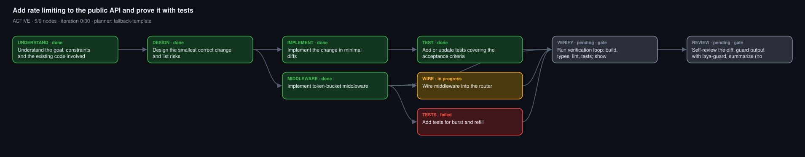
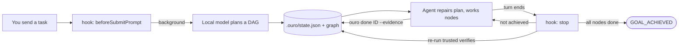

# Ouroboros (`ouro`)

**The loop that eats its own tail until the goal is achieved.**

[](LICENSE)


Ouroboros turns "go do this big task" into a **dependency graph of verifiable steps**, then keeps your coding agent
working until every step is done *and its checks still pass*. A tiny local model (Ollama, default `qwen2.5:3b`)
drafts the plan for free; your agent does the real work; a **stop hook** refuses to let the session end early.

Built for [Cursor](https://cursor.com) (skill + rule + hooks). The engine itself is one stdlib-only Python file and is
editor-agnostic.



*A real graph rendered by `ouro graph` (illustrative goal). Green = done, amber = in progress, red = failed,
grey = pending, purple = blocked. `graph.html` auto-refreshes while the run is active.*

---

## Why

Coding agents fail in a predictable way: they declare victory early, skip the boring part, and forget what they
promised three turns ago. Ouroboros fixes the *incentive*, not the model:

| Without Ouroboros | With Ouroboros |
|---|---|
| "Done!" is the agent's opinion | "Done" means every node is `done` **and** trusted verify commands exit 0 |
| Plan lives in the chat and drifts | Plan is a graph on disk (`.ouro/`), visible, resumable, diffable |
| Regressions go unnoticed | Verify commands re-run on **every loop**; a broken node flips back to `failed` |
| Big model spends tokens planning | A free local 3B model drafts the plan; the big model only codes |
| Runaway loops | Hard caps: 30 iterations, stall detection after 3 identical iterations |
| Agent may run anything | Denylist + optional classifier gate; no commit/push/deploy by default |

## How it works



1. **Start (automatic).** The `beforeSubmitPrompt` hook sees a task (8+ words, not a question) and plans in the
   background. It never delays your prompt.
2. **Plan.** The local model returns 4-8 nodes plus acceptance criteria as JSON. Ouroboros filters them (no
   deploy/push/commit nodes), forces the DAG to be acyclic, and adds two gate nodes: `verify` and `review`.
3. **Repair.** Small models invent steps, so the agent runs `ouro skip|add|set-verify` to fix the plan and adopt
   *real* verification commands. A model-proposed command is only a **hint** and is never executed.
4. **Loop.** `ouro next --claim` -> work -> `ouro done ID --evidence "what proves it"`.
5. **Hold the line.** When the agent tries to stop, the `stop` hook re-runs the trusted verifies. If anything is
   missing or regressed, it sends back *"Not achieved. Continue; don't ask."* with the list of ready and failed nodes.
6. **Finish.** Only when every node is done does the run become `achieved`. If it cannot progress, it becomes
   `blocked` and tells you, rather than looping forever.

See **[docs/ARCHITECTURE.md](docs/ARCHITECTURE.md)** for the data model, state machines, sequence diagrams, safety
layers and design trade-offs.

## Install

Requirements: **Python 3.9+** and, for model plans, [Ollama](https://ollama.com) with a small model.
Tested on macOS (system Python 3.9.6). Linux should work; Windows is untested.

```bash
git clone https://github.com/chetas-opsera/ouroboros.git
cd ouroboros
./install.sh
export PATH="$HOME/.ouroboros/bin:$PATH"     # add to your shell profile

ollama pull qwen2.5:3b                        # the planner (about 1.9 GB)
ollama serve                                  # if it is not already running
ouro doctor                                   # health check
```

`install.sh` is idempotent and **non-destructive**:

| It installs | Where | If it already exists |
|---|---|---|
| CLI + engine | `~/.ouroboros/{bin,skill}` | overwritten (it is ours) |
| Skill (symlink) | `~/.cursor/skills/ouroboros` | left alone |
| Rule | `~/.cursor/rules/ouroboros.mdc` | left alone |
| Hook shim | `~/.cursor/hooks/ouro-hook.sh` | overwritten |
| Hook wiring | `~/.cursor/hooks.json` | **not touched**; it prints the entries to merge |

Override locations with `OURO_HOME` and `CURSOR_HOME`. Remove everything with `./uninstall.sh`.

Without Cursor you can still use the CLI by hand; just skip the hooks (see [Use it without Cursor](#use-it-without-cursor)).

## Quick start

```bash
cd your-project
ouro start "Add rate limiting to the public API and prove it with tests"
ouro status            # the graph as text
ouro graph --open      # the live graph in your browser

ouro skip understand --evidence "not needed"
ouro add "Implement token-bucket middleware" --id middleware --deps design \
    --verify "pytest tests/test_ratelimit.py -q"
ouro next --claim      # claims the next ready node
# ... do the work ...
ouro done middleware --evidence "tests pass"
ouro verify            # re-run all trusted verify commands now
```

In Cursor you do not type any of this. Send a task and the hooks plus rule drive the loop; you watch
`.ouro/graph.html` fill in green.

## Commands

| Command | Purpose |
|---|---|
| `start "<goal>" [--file F] [--max N] [--no-model] [--replace] [--quiet]` | Plan a new run. `--no-model` uses the fallback template |
| `status [--json]` | Goal, state, nodes, acceptance criteria, ready nodes, graph path |
| `wait [--timeout S]` | Block until the background plan finishes |
| `next [--claim]` | Show (and mark in progress) the next ready node |
| `done ID --evidence "..."` | Mark a node done and record why |
| `fail ID --reason "..."` | Mark failed (increments attempts) |
| `block ID --reason "..."` | Mark blocked; stops the run from looping on it |
| `skip ID [--evidence ...]` | Mark not applicable (counts as done) |
| `add "title" [--id] [--deps a,b] [--verify CMD]` | Insert a node before the gate and wire it in |
| `set-verify ID "CMD"` | Adopt a trusted verification command (safety-checked) |
| `verify [IDS...]` | Run trusted verify commands now |
| `graph [--open]` | Re-render `graph.svg`, `graph.html`, `graph.md` (`--open` uses macOS `open`) |
| `abandon` | Mark the run abandoned |
| `warm` | Start optional helpers and check the model server |
| `doctor` | Health check |
| `hook-prompt` `hook-stop` `hook-shell` | Hook handlers (JSON on stdin/stdout); called by `ouro-hook.sh` |

Exit codes: `0` ok, `1` conflict or failed verification, `2` bad input or no run, `3` refused by safety or blocked goal.

## Configuration

| Variable | Default | Meaning |
|---|---|---|
| `OURO_HOME` | `~/.ouroboros` | Install dir; helpers are looked up in `$OURO_HOME/bin` |
| `OURO_OLLAMA_URL` | `http://127.0.0.1:11434` | Ollama endpoint |
| `OURO_MODEL` | `qwen2.5:3b` | Planner model; any Ollama model that supports JSON output |
| `OURO_LAYA_GUARD` | `laya-guard` on `PATH` or `$OURO_HOME/bin` | Optional guard CLI |
| `OURO_MAX_ITER` | `30` | Loop cap before a run becomes `blocked` |
| `OURO_ROOT` | current dir | Workspace root (also `--root`) |
| `OURO_PYTHON` | `python3` | Interpreter used by the launcher |

Workspace state lives in `<workspace>/.ouro/` and is added to `.git/info/exclude` automatically.

## Safety

Ouroboros runs with your permissions, so the defaults are conservative.

- **Model output never executes.** The planner's `verify` strings are stored as hints. Only commands the agent adopts
  with `set-verify` run.
- **Denylist** on every adopted command, checked at adoption *and* before each run: `git push|commit|reset --hard|clean -f|rebase|merge`,
  `rm -rf`, `sudo`, `curl|wget|nc|ssh|scp|rsync`, `kubectl|helm` mutations, `docker push|rm|system prune`,
  `npm|yarn|pnpm publish`, `terraform|pulumi apply|destroy`, writes to system dirs, anything containing `deploy`.
- **Plan policy filter** drops deploy/publish/release/push/commit/merge/production nodes from model plans.
- **Optional [laya-guard](https://github.com/chetas1208/laya-guard)** classifies the goal text and every agent shell
  command (block -> deny, review -> ask). Not required; without it, only the denylist applies. `ouro doctor` tells you which mode you are in.
- **Brakes:** 30-iteration cap, stall detection (3 identical iterations), and aborted/errored sessions never loop.
- **Hooks fail open**, so a broken `ouro` can never wedge your editor.

The denylist is a seatbelt, **not a sandbox**. Read [SECURITY.md](SECURITY.md) for the threat model.

## Use it without Cursor

The engine is plain JSON in, plain JSON out. Any agent runner that can call a shell command at "prompt submitted",
"command about to run" and "turn ended" can use it: pipe the event JSON into `ouro hook-prompt`, `ouro hook-shell`
and `ouro hook-stop`, and treat a `followup_message` in the stop output as the next prompt. Or drive it manually with
the CLI as in Quick start.

## Repository layout

```text
ouroboros/
├── bin/ouro                 launcher (resolves install dir, runs python3)
├── skill/
│   ├── SKILL.md             the Cursor skill (agent-facing docs)
│   └── scripts/ouro.py      the engine: planner, graph, verifier, safety, renderer, hooks
├── hooks/
│   ├── ouro-hook.sh         fail-open hook shim
│   └── hooks.json           Cursor hook wiring (3 hooks)
├── rules/ouroboros.mdc      always-on rule: the agent-side protocol
├── docs/
│   ├── ARCHITECTURE.md      deep dive: data model, state machines, safety, trade-offs
│   └── example-graph.svg    graph produced by the tool itself
├── tests/test_ouro.py       17 stdlib unittest tests
├── install.sh  uninstall.sh
├── SECURITY.md  LICENSE
└── README.md
```

## Development

```bash
python3 -m unittest discover -s tests -v     # 17 tests, ~8 s, no network, no Ollama needed
```

The tests drive the real CLI against throwaway workspaces and cover the planner policy filter and acyclic-DAG
invariant, the denylist, claim/done/skip/add, verification beating self-report, stall-to-blocked, aborted sessions never
looping, hook behaviour with and without laya-guard, and inbox queuing.

## Known limitations

- Any prompt of 8+ words that is not a question starts a run, including conversational follow-ups. The agent is
  expected to `skip` irrelevant nodes. Better intent detection is the obvious next step.
- A 3B planner hallucinates. Treat its plan as a draft: the protocol includes a repair step on purpose.
- No locking on `state.json` (writes are atomic, but concurrent writers are last-wins).
- The denylist is regex-based and can be bypassed by a determined command author.
- Developed and tested on macOS; other platforms are best-effort.

## FAQ

**It started a run for something that was not a task.** Run `ouro skip` on the nodes or `ouro abandon`. Prompts under
8 words and short questions never start a run.

**Plans are generic.** Ollama is not reachable, so the 4-node fallback template was used (`planner=fallback-template`).
Start it with `ollama serve` and run `ouro start --replace`.

**The stop hook keeps sending me back.** That is the point: some node is not `done` or a trusted verify fails.
`ouro status` shows which. If it is stuck, `ouro block ID --reason ...` or `ouro abandon`.

**Where is my data?** Only in `<workspace>/.ouro/`. Nothing leaves your machine except requests to the Ollama URL you
configure (default: localhost).

## License

[MIT](LICENSE). Copyright (c) 2026 Chetas P. All rights reserved except as granted by the license.
