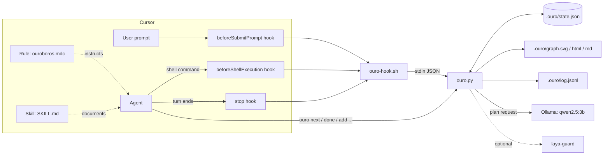
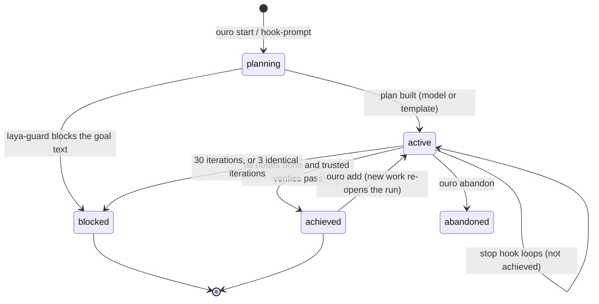
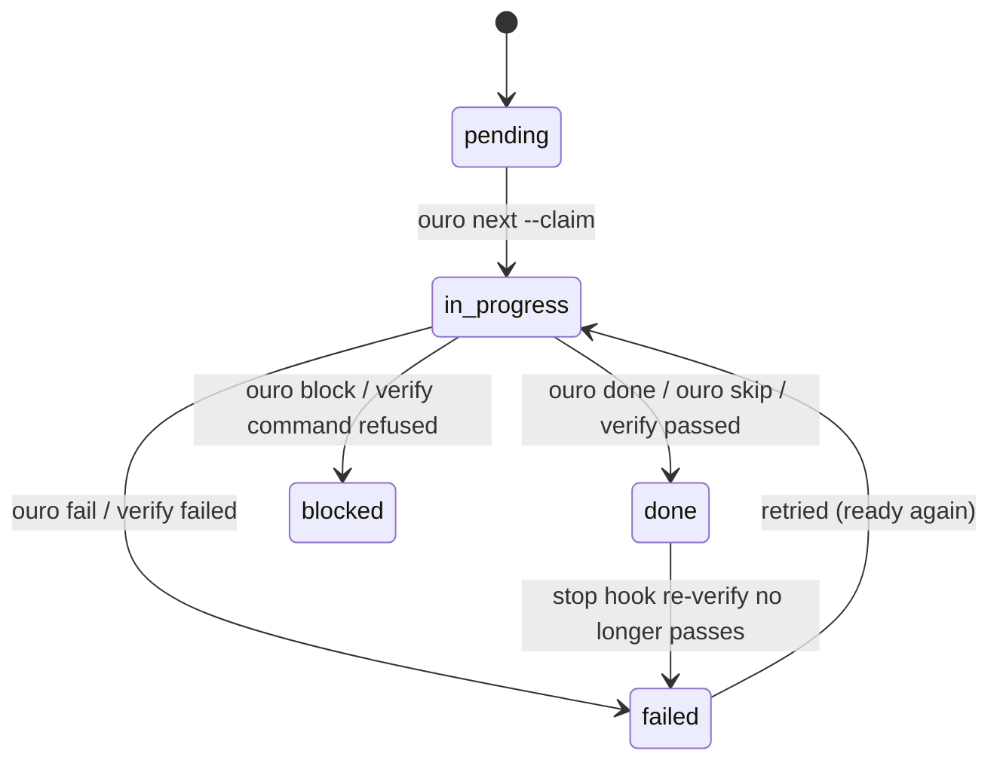

# Architecture

Ouroboros is one Python file (`skill/scripts/ouro.py`, standard library only) plus three thin integration points
for Cursor: a **skill**, an **always-on rule**, and three **hooks**. This document explains how the pieces fit,
what is stored where, and why the design looks the way it does.

## 1. The idea in one paragraph

A coding agent normally stops when it *feels* done. Ouroboros moves the definition of "done" out of the agent's
head and into a **dependency graph of verifiable nodes**. A small local model drafts the graph, the agent repairs
it and works it node by node, and a **stop hook** refuses to let the session end until every node is done and every
trusted verification command still passes. Verification, not self-report, decides.

## 2. Components



| Component | File | Responsibility |
|---|---|---|
| CLI + engine | `skill/scripts/ouro.py` | Planner client, graph model, verification runner, safety checks, SVG/HTML/Mermaid renderer, hook handlers |
| Launcher | `bin/ouro` | Resolves the install dir (follows symlinks), exports `OURO_HOME`, runs `python3` |
| Hook shim | `hooks/ouro-hook.sh` | Reads hook JSON on stdin, calls `ouro hook-<event>`, **fails open** with a neutral response |
| Hook wiring | `hooks/hooks.json` | Registers the three hooks with Cursor (`loop_limit: 30` on `stop`) |
| Rule | `rules/ouroboros.mdc` | `alwaysApply` instructions: the agent-side protocol and the never-commit policy |
| Skill | `skill/SKILL.md` | Discoverable documentation for the agent |

## 3. Data model

State is a single JSON document, written atomically (`state.json.tmp` then rename), so a crash never leaves half a file.

```text
<workspace>/.ouro/
  state.json     the run (below)
  graph.svg      rendered DAG, status-coloured
  graph.html     the SVG + acceptance list; auto-refreshes every 3 s while planning/active
  graph.md       Mermaid flowchart of the same graph
  log.jsonl      append-only event log (start, done, fail, verify, loop, achieved, blocked)
  prompt.txt     the prompt a background plan was started from
  history/       archived runs that were replaced while planning/active/blocked
```

```jsonc
{
  "id": "20261107-002944",
  "goal": "...",
  "status": "planning | active | achieved | blocked | abandoned",
  "iteration": 0, "max_iterations": 30,
  "stalls": 0, "sig": "<signature of node states>",
  "acceptance": ["observable, testable criteria"],
  "planner": { "model": "qwen2.5:3b", "source": "local-model | fallback-template | pending" },
  "guard":   { "decision": "allow | review | block", "reasons": [], "laya_risk": null },
  "inbox":   ["later user messages folded into the run"],
  "nodes": [{
    "id": "slug", "title": "...", "deps": ["earlier-ids-only"],
    "kind": "work | gate",
    "status": "pending | in_progress | done | failed | blocked",
    "verify": "trusted command or null",   // set only via `ouro set-verify`
    "hint":   "model-proposed command or null",  // never executed
    "evidence": "why it is done", "attempts": 0
  }]
}
```

**Two invariants worth knowing**

- `deps` may only reference *earlier* nodes (enforced in `build_nodes`), so the graph is acyclic by construction. No
  cycle detection is needed.
- Every plan ends with two **gate** nodes: `verify` (depends on every leaf) and `review` (depends on `verify`).
  `ouro add` inserts new work *before* the gate and wires it in as a dependency, so a late idea can never be skipped.

## 4. Run lifecycle



### Node lifecycle



A node is **ready** when it is `pending` or `failed` and every dependency is `done`.

## 5. The loop, step by step

```mermaid
sequenceDiagram
  participant U as User
  participant H as Hooks
  participant O as ouro
  participant M as Ollama (3B)
  participant A as Agent
  U->>H: prompt (8+ words, not a question)
  H->>O: hook-prompt (returns instantly)
  O-->>M: plan request (background process)
  M-->>O: JSON: nodes + acceptance
  O->>O: build_nodes: filter, dedupe, add gates, render graph
  A->>O: ouro wait / status
  A->>O: fix plan: skip / add / set-verify
  loop until GOAL_ACHIEVED
    A->>O: next --claim
    A->>A: do the work
    A->>O: done ID --evidence ...
    A->>H: end turn
    H->>O: hook-stop
    O->>O: re-run trusted verifies, check all_done, stall/cap
    O-->>H: followup_message (or {} when finished)
    H-->>A: "Not achieved. Continue; don't ask."
  end
```

### 5.1 `beforeSubmitPrompt` -> `hook-prompt`

Always returns `{"continue": true}` first, so it never delays the prompt. Then:

1. `is_task()` decides whether the prompt is a task: at least **8 words**, and not a short (<40 words) question or lookup
   (ends in `?` or starts with what/how/why/show/tell/explain/list/...). Questions answer in one turn: no run, no loop.
2. Optional helpers (`laya-serve`, `ollama-local`) are warmed in the background if present.
3. If a run is already `planning`/`active` and was touched in the last 30 minutes, the prompt is appended to the
   run's `inbox` (600 chars) instead of starting a new run. A run idle for more than 30 minutes is stale and is replaced.
4. Otherwise a **detached** process runs `ouro start --file .ouro/prompt.txt --replace --quiet`. Planning can take
   seconds on a cold model; the hook does not wait.

### 5.2 Planning (`ask_model`, `build_nodes`)

- The prompt to the model contains a compact **workspace map** (`repo_context`: up to 70 paths, depth <= 3, skipping
  `node_modules`, `.git`, build output, etc., plus `package.json` script names) so a 3B model plans against real paths.
- Ollama `/api/chat` with a **JSON schema** (`format`), `temperature 0.2`, `num_ctx 8192`, `keep_alive 30m`.
  One retry after 3 s on a cold load or malformed JSON; 180 s timeout.
- `build_nodes` is the trust boundary between a small model and your repo:
  - at most 9 model nodes; titles clipped to 100 chars; ids slugged and de-duplicated
  - deps filtered to **earlier** ids only
  - a regex **policy filter** drops nodes about deploy/publish/release/push/commit/merge/pull request/production
  - the model's `verify` string is stored as `hint` and **never runs**
  - if the model is down or returns nothing usable, a 4-node **fallback template** (understand, design, implement, test)
    is used and `planner.source` says `fallback-template`
  - `verify` and `review` gate nodes are appended
- The goal text itself is checked by laya-guard (`--kind prompt`) when installed: `block` blocks the run, `review`
  flags it so the agent asks you before acting.

### 5.3 Working the graph (agent side)

`next [--claim]`, `done`, `fail`, `block`, `skip`, `add`, `set-verify`, `verify`, `status`, `graph`. The rule file tells
the agent to **repair the plan first**: small models invent steps, so the agent skips nonsense nodes, adds real ones, and
adopts real verification commands with `set-verify`.

### 5.4 Verification (`run_verify`)

Only nodes with a trusted `verify` command are checked, and only if they are not `pending`.

1. `safe_cmd`: denylist, then laya-guard (when installed). Refused -> node becomes `blocked`.
2. `subprocess.run(cmd, shell=True, cwd=<workspace>, timeout=900)` with `$OURO_HOME/bin` first on `PATH` (hooks run
   with a minimal `PATH`, so this makes verification behave the same in a hook as in your terminal).
3. Exit 0 -> `done`; non-zero -> `failed` and `attempts += 1`; timeout -> `failed`.

### 5.5 The stop hook (`hook-stop`)

This is the heart of the loop. On every end-of-turn:

1. If the run is not `active`, or the session `status` is `aborted`/`error`, return `{}`: **an aborted or crashed session
   never loops**.
2. Re-run the trusted verifies for every node currently `done` or `failed`. A node the agent fixed flips to `done` on its
   own, and a node marked `done` that no longer verifies flips back to `failed`.
3. If every node is `done` -> `achieved`, return `{}`.
4. Compute a **signature** of `(id, status, attempts)` for all nodes. If it equals the previous signature, `stalls += 1`,
   else `stalls = 0`.
5. `iteration += 1`. If `iteration >= max_iterations` (default 30) **or** `stalls >= 3` -> `blocked` with a reason, return `{}`.
6. Otherwise return `{"followup_message": ...}` listing the ready nodes and any failed/blocked ones with their evidence.
   Cursor delivers that as the next user turn.

Two independent brakes (iteration cap and stall detection) plus Cursor's own `loop_limit: 30` mean it cannot run forever.

### 5.6 Shell gate (`hook-shell`)

Every agent shell command goes to laya-guard (`--kind command`): `block` -> `deny` (with an instruction to the agent not
to retry via rephrasing), `review` -> `ask` (the user decides), else `allow`. If laya-guard is not installed this hook
allows everything; the denylist still protects `set-verify`.

## 6. Rendering

`render()` lays nodes out in columns by longest-path depth and draws cubic-Bezier edges, status-coloured boxes and a
progress header, as plain SVG strings (no dependencies). The HTML wrapper auto-refreshes every 3 s while the run is
`planning` or `active`, so you can keep `graph.html` open beside the editor and watch nodes turn green.
`graph.md` is the same graph as Mermaid, which renders natively on GitHub.

Colours: grey = pending, amber = in progress, green = done, red = failed, purple = blocked.

## 7. Design decisions and trade-offs

| Decision | Why | Cost |
|---|---|---|
| **Local 3B model plans; the big agent codes** | Planning is cheap, private and offline; it does not spend your frontier-model tokens. | A 3B model hallucinates. Plans always need a repair pass (see limitations). |
| **Model verify commands are hints, not commands** | A small model must never get remote-code-execution on your box. | One extra step: the agent adopts a command with `set-verify`. |
| **Verification beats self-report** | "I'm done" is the most common agent failure. Re-running checks on every loop catches regressions. | Slow verify commands run every loop; keep them fast. |
| **Single-file, stdlib-only** | Zero install friction, auditable in one sitting, runs on the macOS system Python (3.9). | One large file; no plugin API yet. |
| **Hooks fail open** | A bug in a helper must not brick the editor. | A missing guard silently degrades to denylist-only; `ouro doctor` reports it. |
| **Acyclic by construction** | Deps must name earlier ids, so no cycle detection or deadlock handling. | The model cannot express a forward dependency; the agent can reorder with `add`. |
| **State in the workspace (`.ouro/`)** | Per-project runs, easy to inspect, auto-excluded from git. | Not shared across machines. |
| **Atomic JSON writes** | Hooks and the agent can touch state concurrently; a torn file would lose the run. | Last-writer-wins on concurrent updates (no locking). |

## 8. Extension points

- **Planner:** set `OURO_MODEL` / `OURO_OLLAMA_URL`, or replace `ask_model` (it only has to return the `PLAN_SCHEMA` shape).
- **Policy:** edit `DENY` (command denylist) and the `forbidden` regex in `build_nodes` (plan filter).
- **Guard:** point `OURO_LAYA_GUARD` at any executable that reads stdin and exits `0` allow / `10` review / `20` block.
- **Other editors:** the engine is editor-agnostic. `hook-prompt`, `hook-stop` and `hook-shell` speak plain JSON on
  stdin/stdout; only `hooks.json` and the rule are Cursor-specific.

## 9. Known limitations

- **Any prompt of 8+ words that is not a question starts a run**, including conversational follow-ups like
  "commit and push this". The agent is expected to `skip` irrelevant nodes. A smarter intent classifier is the obvious next step.
- **No concurrency control** on `state.json` (atomic replace, but last writer wins).
- **The denylist is not a sandbox** (see `SECURITY.md`).
- `verify` commands run with `shell=True`; quoting and redirections behave as in `sh`.
- Planner quality depends entirely on the local model; with no model reachable you get the generic template.
