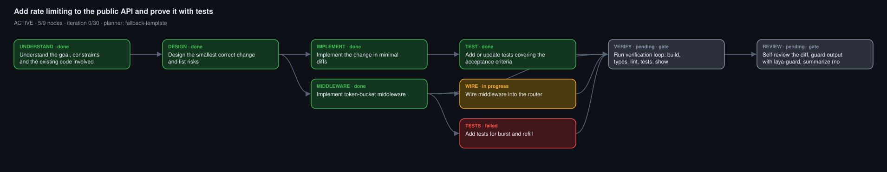

# Ouroboros (`ouro`)

The loop that eats its own tail until the goal is achieved.

## How it starts (automatic)

`~/.cursor/hooks.json` wires three hooks to `ouro`:

| Hook | What it does |
|---|---|
| `beforeSubmitPrompt` | Warms the optional helper daemons (if installed). If the prompt looks like a task (8+ words, not a short question), plans in the background with the local model. Returns instantly. |
| `beforeShellExecution` | Runs every shell command through laya-guard (if installed): allow, ask, or deny. Without it, everything is allowed. |
| `stop` | Re-verifies. If the goal is not achieved, sends a follow-up message so the agent keeps going (cap 30 loops). |

Rule `~/.cursor/rules/ouroboros.mdc` makes the agent follow the protocol below.

## Protocol (agent side)

```bash
export PATH="$HOME/.ouroboros/bin:$PATH"
ouro wait            # wait for the background plan (max ~60s)
ouro status          # read the graph; if no run exists: ouro start "<goal>"
```

1. Repair the plan: `ouro skip ID`, `ouro add "title" --deps a,b`, `ouro set-verify ID "cmd"`.
   Model verify commands are only hints. Adopt real ones with `set-verify`.
2. Loop: `ouro next --claim`, do the work, `ouro done ID --evidence "what proves it"`.
   On failure: `ouro fail ID --reason ...`. If you cannot proceed: `ouro block ID --reason ...`.
3. Run `ouro verify` before claiming the gate nodes. Do not stop early. The stop hook will bounce you back.
4. Finish only on `GOAL_ACHIEVED`. Stop and report to the user on `BLOCKED` or `GUARD REVIEW`.

## Commands

`start [--file --max --no-model --replace --quiet]`, `status [--json]`, `wait`, `next [--claim]`,
`done`, `fail`, `block`, `skip`, `verify [ids]`, `set-verify`, `add`, `graph [--open]`,
`abandon`, `warm`, `doctor`.

State lives in `<workspace>/.ouro/` (`state.json`, `graph.svg`, `graph.html` auto-refresh, `graph.md` mermaid, `log.jsonl`). It is git-excluded automatically.

## Safety

- Verify commands pass a denylist plus laya-guard, so there is no push/commit/merge/deploy/sudo/curl/rm -rf.
- Plans drop deploy/publish/release/push/commit/merge/production nodes.
- 3 idle loops means BLOCKED. 30 loops means BLOCKED. An aborted or errored session never loops.
- Hooks fail open, so a broken `ouro` never wedges Cursor.
- Never commit, push, or open PRs unless the user asks.

## Runtime

- Python 3.9+ (stdlib only). Install dir `~/.ouroboros` (`OURO_HOME`).
- Planner: any local Ollama model, default `qwen2.5:3b` at `http://127.0.0.1:11434` (`OURO_OLLAMA_URL`, `OURO_MODEL`). If no model is reachable, plans fall back to a generic template.
- Optional: `laya-guard` for classifier-backed command checks (`OURO_LAYA_GUARD`). Without it, only the deterministic denylist applies.
- Health: `ouro doctor`. The local 3B model only plans. The Cursor agent does the coding.


